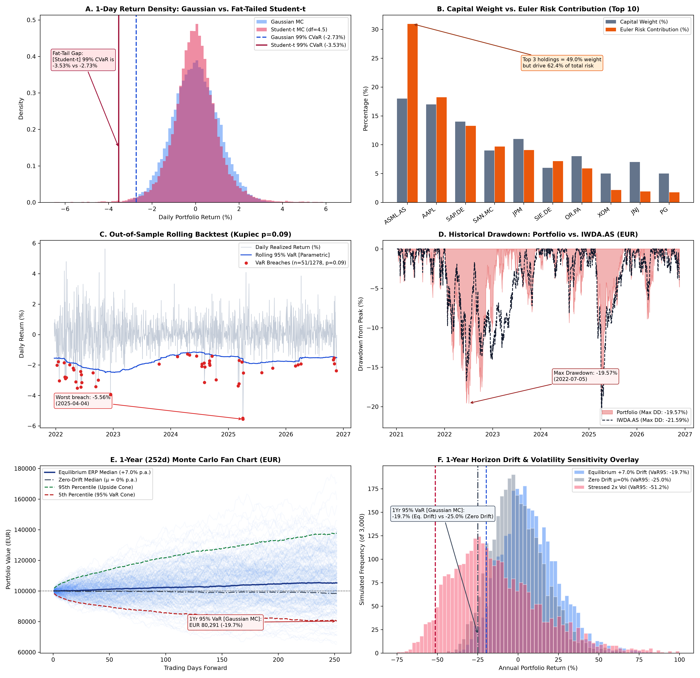

# Multi-Currency Equity Portfolio Risk & Attribution Engine

A portfolio-agnostic quantitative market risk, attribution, and governance framework in Python. Built to evaluate multi-currency equity portfolios against a passive global benchmark (`IWDA.AS` in EUR) and generate a print-ready HTML/PDF diagnostic report for both technical and non-specialist readers.



---

## 1. Purpose & Key Capabilities

1. **Multi-Currency Spot FX Pipeline (`src/data_pipeline.py`):** Converts non-base-currency equities into the configured reporting currency (`EUR`, `USD`, etc.) using daily Yahoo Finance spot exchange rates (`EURUSD=X`, etc.), embedding currency volatility and equity-FX covariance directly into return series.
2. **Four VaR & Expected Shortfall (CVaR) Models (`src/risk_models.py`):** Compares 95% and 99% VaR and CVaR across **Historical Simulation**, **Parametric (Variance-Covariance)**, **Gaussian Cholesky Monte Carlo**, and **Variance-Matched Multivariate Student-$t$ Monte Carlo** (with MLE-fitted degrees of freedom $\nu$ and shared radial $\chi^2_\nu$ tail dependence).
3. **Benchmark-Relative & Multi-Horizon Analysis:** Evaluates portfolio volatility, compound return, Sharpe/Sortino ratios, drawdowns, **1-Day** monitoring VaR, **10-Day (2-Week)** governance VaR, and **1-Year (252-Day)** drift sensitivity (Zero Drift, Equilibrium ERP, Sample Drift, and $2\times$ Volatility Stress) alongside a configurable global benchmark (`IWDA.AS`).
4. **Euler Risk Attribution (`src/attribution.py`):** Decomposes 100% of Parametric VaR into position-level **Marginal VaR**, **Component VaR**, **External Benchmark Beta**, **Risk / Weight Ratio**, **Diversification Ratio**, and **Effective Number of Capital vs. Risk Bets ($N_{\text{eff}}$)**.
5. **Rule-Based Risk Governance & Rebalancing Simulator (`src/advisory.py`):** Evaluates 8 configurable traffic-light governance checks scaled to portfolio size and simulates the risk-only impact of trimming flagged Risk Amplifiers into Diversifiers.
6. **Out-of-Sample Backtesting & Crisis Stress Tests (`src/validation.py`):** Runs a 252-day rolling out-of-sample backtest with a **Kupiec (1995) Proportion of Failures (POF)** likelihood-ratio test (automatically disabling with an explanatory notice if history $< 500$ days), plus historical crisis replays (**2008–09 GFC**, **2020 COVID-19 Crash**, **2022 Rate Shock**) and configurable sector/FX factor shocks.

---

## 2. Quickstart

```bash
# 1. Clone repository and create virtual environment
python -m venv .venv
source .venv/bin/activate        # On Windows: .\.venv\Scripts\Activate.ps1

# 2. Install pinned dependencies
pip install -r requirements.txt

# 3. Run the automated unit & multi-portfolio robustness test suite (11 tests)
python -m pytest tests/test_risk_engine.py -v

# 4. Run on the public 10-stock illustrative demo portfolio (outputs to outputs/public/)
python run_analysis.py --config config/portfolio.example.json

# 5. Run on your own private portfolio (add to config/portfolio_private.json, gitignored)
python run_analysis.py --config config/portfolio_private.json

# 6. Optional: Anonymize tickers and normalize NAV to 100,000 for public sharing
python run_analysis.py --config config/portfolio_private.json --anonymize
```

---

## 3. Configuration Schema (`config/portfolio.example.json`)

Any portfolio can be analyzed by supplying a JSON file with `shares`, `amount`, or `weight` position sizing:

```json
{
  "portfolio_name": "Global Multi-Currency Demo Portfolio (Illustrative)",
  "is_private": false,
  "settings": {
    "base_currency": "EUR",
    "start_date": "2021-01-01",
    "benchmark_ticker": "IWDA.AS",
    "benchmark_currency": "EUR",
    "benchmark_crisis_proxy": "SPY",
    "benchmark_crisis_proxy_currency": "USD",
    "risk_free_rate": 0.025,
    "equilibrium_erp": 0.07,
    "random_seed": 42
  },
  "holdings": [
    {"ticker": "ASML.AS", "weight": 0.18, "currency": "EUR", "sector": "Information Technology", "region": "Europe"},
    {"ticker": "AAPL",    "weight": 0.17, "currency": "USD", "sector": "Information Technology", "region": "North America"}
  ]
}
```
*Note: `config/portfolio.example.json` is an illustrative 10-stock portfolio created solely for software demonstration and verification; it does not represent any real fund or investment advice.*

---

## 4. Model Limitations & Data-Source Notice

* **Key Modeling Limitations:** (1) Current weights are applied retroactively across the historical lookback window (survivorship/selection bias); (2) sample mean returns over multi-year windows carry large estimation error ($\sigma / \sqrt{T}$), so short-horizon VaR sets $\mu = 0$ and 1-year simulations report zero-drift and equilibrium ERP baselines; (3) static linear covariance matrices do not capture crisis correlation spikes toward $1.0$; (4) Student-$t$ tails are elliptically symmetric; and (5) pre-IPO holdings in 2008/2020 stress replays are approximated via sector ETF proxies. See [`METHODOLOGY.md`](METHODOLOGY.md) for full derivations.
* **Data-Source & Licensing Notice:** Historical market prices and spot FX rates are fetched dynamically at runtime via `yfinance` for personal and educational research purposes only. No proprietary market data or private portfolio holdings are stored or redistributed in this repository. Released under the [MIT License](LICENSE).

---

## 5. Acknowledgements & Open-Source Inspirations

* **Riskfolio-Lib** (`dcajasn/Riskfolio-Lib`, BSD-3-Clause License) & **skfolio** (`skfolio/skfolio`, BSD-3-Clause License) — Inspiration for Euler risk contribution charts, Effective Number of Bets ($N_{\text{eff}}$), and Choueifaty's Diversification Ratio.
* **QuantStats** (`ranaroussi/quantstats`, Apache-2.0 License) & **pyfolio-reloaded** (`stefan-jansen/pyfolio-reloaded`, Apache-2.0 License) — Inspiration for self-contained HTML tearsheets, benchmark-relative drawdown curves, and historical crisis replay tables.
* **PyPortfolioOpt** (`robertmartin8/PyPortfolioOpt`, MIT License) — Inspiration for modular API design and documentation of sample mean estimation error.